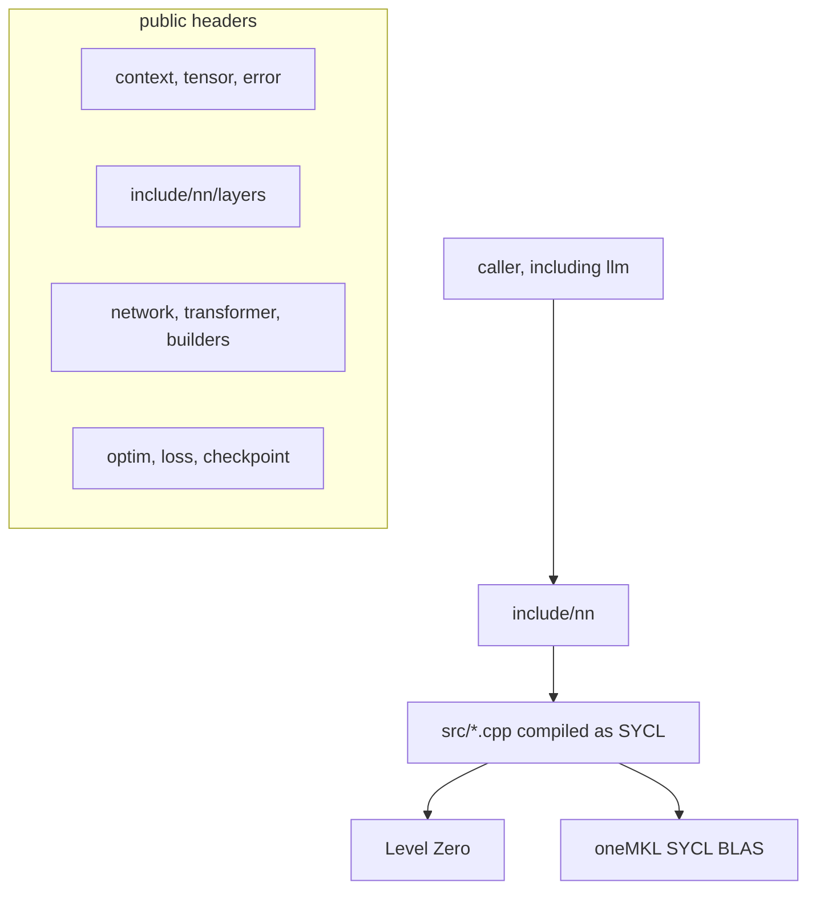
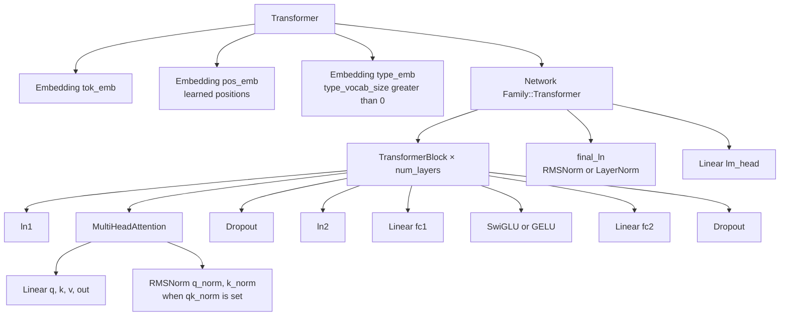

# Code structure

This tree is the Intel Arc implementation of namespace `nn`. Public headers live under `include/nn/` and do not include SYCL or oneMKL headers. The static library target is `nn`. The call contract is [api.md](api.md).

`src/checkpoint.cpp`, `include/nn/transformer.hpp`, and `include/nn/layer.hpp` are the same bytes in `nnCUDA`, `nnCL`, `nnROCm`, and `nnArc`. This tree has no `include/nn/dtype.hpp`. `Context` has no `set_activation_dtype`. `Tensor::data()` returns `float*`. Parameters and activations are float32.

`include/nn/context.hpp` opens an Intel GPU by index. There is no process-wide current device.

## Where a call lands

`include/` is on the public include path. `src/` is private. Host files and kernels are C++ compiled with `-fsycl`. `gemm.hpp` calls oneMKL column-major GEMM.

## Public headers

| Header | Types |
|---|---|
| `nn/error.hpp` | `Error` |
| `nn/context.hpp` | `Context`, `DeviceInfo`, `detect_devices`, `select_device` |
| `nn/tensor.hpp` | `Tensor`. Storage is float32. |
| `nn/index_tensor.hpp` | `IndexTensor`, `DeviceIndices` |
| `nn/layer.hpp` | `Layer`, `NamedParam`, `NamedBuffer` |
| `nn/layers/*.hpp` | One class per file: `Linear`, `Embedding`, `ReLU`, `GELU`, `SwiGLU`, `Dropout`, `LayerNorm`, `RMSNorm`, `MultiHeadAttention`, `TransformerBlock`, `RNN`, `LastStep`, `Conv2d`, `MaxPool2d`, `BatchNorm2d`, `Flatten`, `GlobalAvgPool2d`, `ResidualBlock` |
| `nn/config.hpp` | Config structs and `validate` |
| `nn/network.hpp` | `Network`, `Family` |
| `nn/transformer.hpp` | `Transformer`, `Transformer::Loaded`, `GenerateState` |
| `nn/conv_resnet.hpp` | `ConvResNet` |
| `nn/builders.hpp` | `build_mlp`, `build_conv`, `build_resnet`, `build_conv_resnet`, `build_rnn`, `build_transformer_network` |
| `nn/optim.hpp` | `Sgd`, `AdamW`, `AdamWGroup` |
| `nn/loss.hpp` | `LossResult`, `softmax_cross_entropy`, `sequence_cross_entropy` |
| `nn/checkpoint.hpp` | `LoadMode` and the checkpoint helpers `Network::save` uses |
| `nn/init.hpp` | `kaiming_normal` |

`Family` is `Mlp` 1, `Conv` 2, `ResNet` 3, `ConvResNet` 4, `Rnn` 5, and `Transformer` 6. `build_transformer_network` returns a `Network` of that family. `llm` constructs `Transformer` directly. That object owns the embeddings and holds the `Network` for the blocks, the final norm, and the LM head.

## Transformer ownership

Embeddings sit outside the `Network`. Block pointers are captured before each block is moved into the network, so `GenerateState` can call `TransformerBlock::forward_cached` on the same objects.

`pos_emb` is absent when `positional` is RoPE. `ln1` and `ln2` are `RMSNorm` in that case and `LayerNorm` otherwise. `fc1` writes `2 * d_ff` for SwiGLU and `d_ff` for GELU. `q_norm` and `k_norm` exist when `qk_norm` is set. `forward` and `backward` return a `const Tensor&` into storage owned by that layer.

`Context` owns one in-order `sycl::queue`. Tensors, layers, and optimizers borrow it. Device memory is USM from `sycl::malloc_device`. `Tensor` is the device-buffer owner. `NamedParam` holds pointers into those tensors. `Sgd` and `AdamW` copy the pointer list and own their moment tensors.

## Sources in this tree

Every library file is `src/*.cpp`.

| Group | Files |
|---|---|
| Device | `context.cpp`, `tensor.cpp`, `error.cpp`, `index_tensor.cpp`, `elementwise.cpp` |
| Layers | `linear.cpp`, `embedding.cpp`, `relu.cpp`, `gelu.cpp`, `swiglu.cpp`, `dropout.cpp`, `layer_norm.cpp`, `rms_norm.cpp`, `multi_head_attention.cpp`, `rnn.cpp`, `last_step.cpp`, `conv2d.cpp`, `max_pool2d.cpp`, `batch_norm2d.cpp`, `flatten.cpp`, `global_avg_pool2d.cpp`, `residual_block.cpp` |
| Trunk | `transformer_block.cpp`, `transformer.cpp`, `network.cpp`, `builders.cpp`, `config.cpp`, `init.cpp` |
| Optim and loss | `optim.cpp`, `sgd.cpp`, `adamw.cpp`, `loss.cpp` |
| Checkpoint | `checkpoint.cpp` |

Private headers stay in `src/`: `check.hpp`, `context_impl.hpp`, `device.hpp`, `ensure.hpp`, `gemm.hpp`, `kernels.hpp`, `launch.hpp`, `reduce_device.hpp`. `Context` keeps the SYCL queue behind `Context::Impl`.

## Tests

`tests/test_main.cpp` is `nn_tests`. The argument selects `shapes`, `grads`, `ckpt`, or `mnist`.

| File | Role |
|---|---|
| `test_shapes.cpp` | Shapes of the layers and the trunk |
| `test_gradients.cpp` | Analytic gradients against numeric gradients |
| `test_checkpoint.cpp` | Save and load |
| `test_mnist.cpp` | MNIST for the MLP, conv, ResNet, and ConvResNet builders |
| `mnist.cpp` | IDX reader used by the MNIST test |

## Sibling trees

| Tree | `llm` marker | Device code | Activations |
|---|---|---|---|
| `nnCUDA` | no marker file | `.cu` plus cuBLAS and cuDNN | bfloat16 by default |
| `nnCL` | `src/kernels.cl` | `kernels.cl`, loaded at runtime | bfloat16 by default |
| `nnROCm` | `src/elementwise.hip` | `.hip` plus hipBLAS and rocBLAS | bfloat16 by default |
| `nnArc` | `src/elementwise.cpp` | SYCL C++ and oneMKL | float32, no `dtype.hpp` |

`llm` is the sibling that calls `Transformer`, `sequence_cross_entropy`, and `AdamW`. Its layout is `docs/code-structure.md` in that repository.
